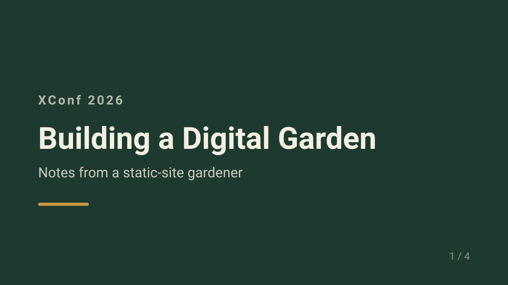
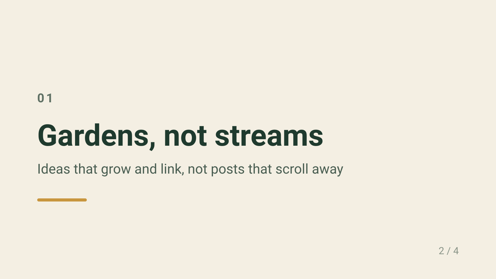
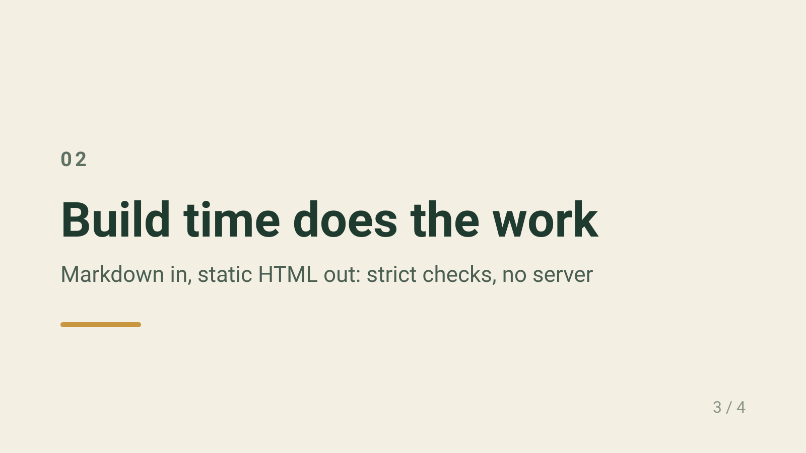
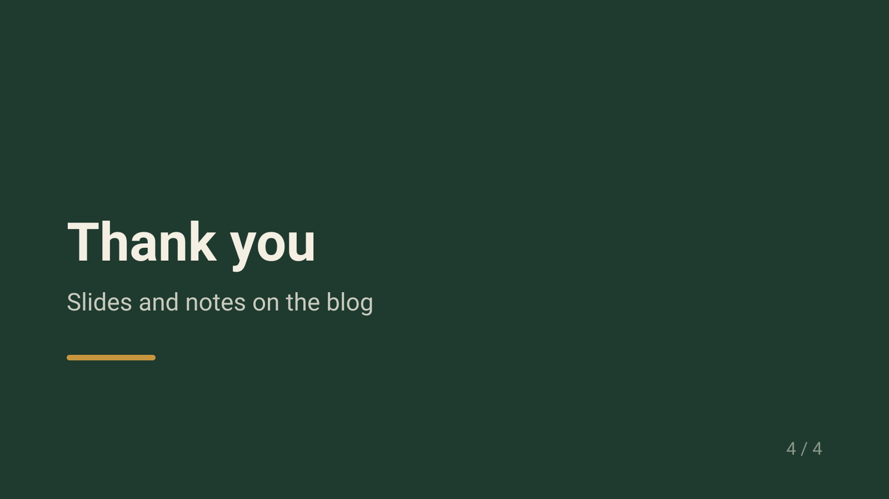

# Slides from my XConf talk

Gave a short talk on digital gardens at XConf today. The slides are below: flip through them with the arrows or the arrow keys, click a slide to present it, and press <kbd>F</kbd> for fullscreen. Every slide has its own link, so `#slides-3` opens the deck on the third.

:::slides[Building a Digital Garden — XConf 2026]{video="https://www.youtube.com/watch?v=jNQXAC9IVRw"}

:::

This entry is a folder flow, `2026/03/10/index.md` with a `slides/` folder beside it, because a deck's images must sit next to the content. `bun run new-flow --folder` starts one, and `bun run new-slides <export> --into <that folder>` copies the slides in and prints the block above.
