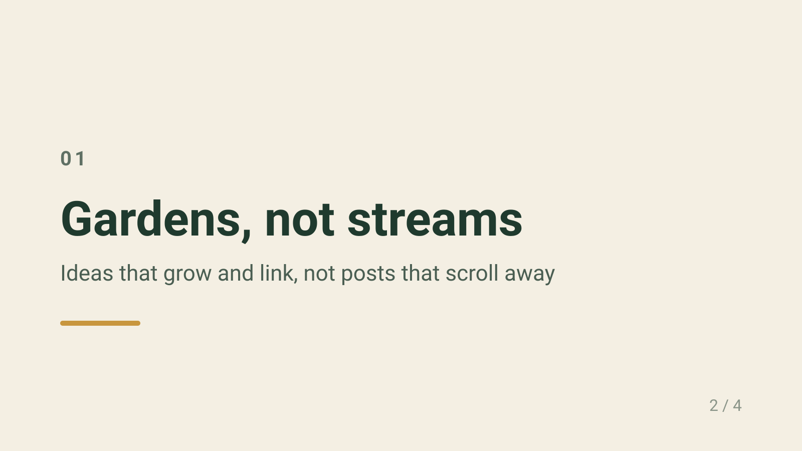
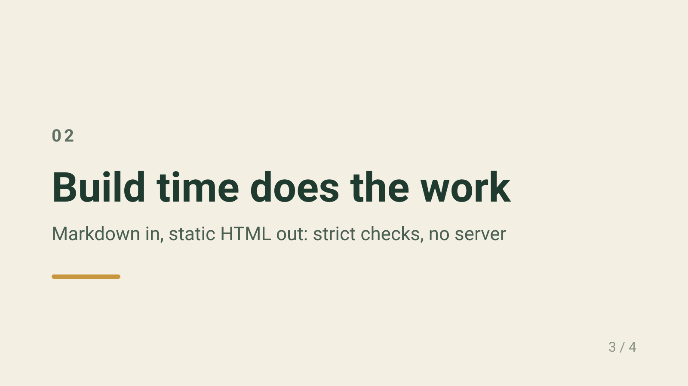

This post tests how Amytis renders multimedia content embedded via raw HTML iframes and native HTML5 media elements. Since `rehype-raw` is enabled, standard HTML embed codes work directly inside Markdown.

---

## YouTube Video

Responsive 16:9 YouTube embed using a padded wrapper:

<div style="position: relative; padding-bottom: 56.25%; height: 0; overflow: hidden; border-radius: 12px; margin: 1.5rem 0;">
  <iframe
    src="https://www.youtube.com/embed/jNQXAC9IVRw?rel=0"
    style="position: absolute; top: 0; left: 0; width: 100%; height: 100%; border: 0;"
    allow="accelerometer; autoplay; clipboard-write; encrypted-media; fullscreen; gyroscope; picture-in-picture; web-share"
    title="Me at the zoo — first YouTube video ever uploaded (2005)"
  ></iframe>
</div>

*"Me at the zoo" — the very first video uploaded to YouTube (April 23, 2005).*

---

## Vimeo Video

Vimeo also supports responsive 16:9 embedding:

<div style="position: relative; padding-bottom: 56.25%; height: 0; overflow: hidden; border-radius: 12px; margin: 1.5rem 0;">
  <iframe
    src="https://player.vimeo.com/video/76979871?color=ff9933&title=0&byline=0&portrait=0"
    style="position: absolute; top: 0; left: 0; width: 100%; height: 100%; border: 0;"
    allow="autoplay; fullscreen; picture-in-picture"
    title="Big Buck Bunny — Blender Foundation (Vimeo)"
  ></iframe>
</div>

*Big Buck Bunny (2008) — open-source animated short by the Blender Foundation.*

---

## Podcast Embeds

### Spotify Podcast

Spotify provides a fixed-height iframe embed for individual episodes:

<iframe
  src="https://open.spotify.com/embed/episode/0b8q6Q7fKqZLlSc0Lh1WQe?utm_source=generator&theme=0"
  style="border-radius: 12px; margin: 1rem 0;"
  width="100%"
  height="152"
  frameborder="0"
  allow="autoplay; clipboard-write; encrypted-media; fullscreen; picture-in-picture"
  loading="lazy"
  title="Spotify Podcast Episode"
></iframe>

You can also embed the full show player at a taller height (352px) to show the episode list:

<iframe
  src="https://open.spotify.com/embed/show/5as3aKmN2k11yfDDDSrvaZ?utm_source=generator"
  style="border-radius: 12px; margin: 1rem 0;"
  width="100%"
  height="352"
  frameborder="0"
  allow="autoplay; clipboard-write; encrypted-media; fullscreen; picture-in-picture"
  loading="lazy"
  title="Spotify Show Player"
></iframe>

### Apple Podcasts

Apple Podcasts uses a similar iframe embed pattern:

<iframe
  src="https://embed.podcasts.apple.com/us/podcast/syntax-tasty-web-development-treats/id1253186678?itsct=podcast_box_player&amp;itscg=30200&amp;ls=1&amp;theme=auto"
  height="175px"
  frameborder="0"
  sandbox="allow-forms allow-popups allow-same-origin allow-scripts allow-top-navigation-by-user-activation"
  allow="autoplay *; encrypted-media *; clipboard-write"
  style="width: 100%; max-width: 660px; overflow: hidden; border-radius: 10px; margin: 1rem 0; display: block;"
  title="Apple Podcasts — Syntax.fm"
></iframe>

---

## Livestream Embeds

### YouTube Live

A YouTube Live channel or active live video can be embedded exactly like a regular video. Use the channel's live URL (`/live`) or a live event ID:

```html
<!-- Replace CHANNEL_ID with the YouTube channel ID -->
<iframe
  src="https://www.youtube.com/embed/live_stream?channel=CHANNEL_ID"
  ...
></iframe>
```

Below is NASA's public live stream:

<div style="position: relative; padding-bottom: 56.25%; height: 0; overflow: hidden; border-radius: 12px; margin: 1.5rem 0;">
  <iframe
    src="https://www.youtube.com/embed/xAieE-QtOeM?autoplay=0"
    style="position: absolute; top: 0; left: 0; width: 100%; height: 100%; border: 0;"
    allow="accelerometer; autoplay; clipboard-write; encrypted-media; fullscreen; gyroscope; picture-in-picture"
    title="NASA TV Live"
  ></iframe>
</div>

### Twitch Stream

Twitch requires your site's hostname in the `parent` query parameter (so the embed works in production):

```html
<!-- Replace CHANNEL_NAME with a Twitch channel, and your-domain.com with your domain -->
<iframe
  src="https://player.twitch.tv/?channel=CHANNEL_NAME&parent=your-domain.com"
  height="378"
  width="100%"
  allow="fullscreen"
  title="Twitch Stream"
></iframe>
```

Twitch also supports embedding past broadcasts (VODs) and clips:

```html
<!-- VOD -->
<iframe src="https://player.twitch.tv/?video=VOD_ID&parent=your-domain.com" ...></iframe>
<!-- Clip -->
<iframe src="https://clips.twitch.tv/embed?clip=CLIP_SLUG&parent=your-domain.com" ...></iframe>
```

---

## HTML5 Native Media

Native `<video>` and `<audio>` elements work without any third-party embeds.

### HTML5 Video

<video controls style="width: 100%; border-radius: 12px; margin: 1rem 0; background: #000;" poster="https://peach.blender.org/wp-content/uploads/title_anouncement.jpg">
  <source src="https://commondatastorage.googleapis.com/gtv-videos-bucket/sample/ElephantsDream.mp4" type="video/mp4" />
  Your browser does not support the HTML5 video element.
</video>

*Elephants Dream (2006) — first open-source animated film by the Blender Foundation.*

Attributes you can use:

| Attribute | Description |
| :--- | :--- |
| `controls` | Show playback controls |
| `autoplay` | Start playing automatically (use with `muted`) |
| `muted` | Mute by default (required for autoplay) |
| `loop` | Loop the video |
| `poster` | Preview image shown before play |
| `preload` | `auto` \| `metadata` \| `none` |

### HTML5 Audio

<audio controls style="width: 100%; margin: 1rem 0;">
  <source src="https://www.soundhelix.com/examples/mp3/SoundHelix-Song-1.mp3" type="audio/mpeg" />
  Your browser does not support the HTML5 audio element.
</audio>

*SoundHelix royalty-free sample track.*

Multiple formats improve cross-browser support:

```html
<audio controls>
  <source src="audio.ogg" type="audio/ogg" />
  <source src="audio.mp3" type="audio/mpeg" />
  Your browser does not support the HTML5 audio element.
</audio>
```

---

## Audio Platforms

### SoundCloud

SoundCloud exposes an iframe embed from any track's "Share → Embed" menu:

<iframe
  width="100%"
  height="166"
  scrolling="no"
  frameborder="no"
  allow="autoplay"
  style="border-radius: 8px; margin: 1rem 0;"
  src="https://w.soundcloud.com/player/?url=https%3A//api.soundcloud.com/tracks/1&color=%23ff5500&auto_play=false&hide_related=false&show_comments=true&show_user=true&show_reposts=false&show_teaser=true"
  title="SoundCloud track"
></iframe>

The full visual player (300px height) shows the waveform:

```html
<iframe
  width="100%"
  height="300"
  src="https://w.soundcloud.com/player/?url=TRACK_URL&visual=true"
  ...
></iframe>
```

### Bandcamp

Bandcamp provides both album and track embed codes:

```html
<!-- Album embed -->
<iframe
  style="border: 0; width: 100%; height: 120px;"
  src="https://bandcamp.com/EmbeddedPlayer/album=ALBUM_ID/size=large/bgcol=ffffff/linkcol=0687f5/"
  seamless
></iframe>
```

---

## Slide Decks

Talk slides exported as images (Keynote, PowerPoint, Google Slides) go in a `:::slides` block, one Markdown image per slide. Flip through with the arrows, the arrow keys or a swipe; click a slide or press <kbd>F</kbd> for the fullscreen presenter; link to a slide with `#slides-3`.

:::slides[Building a Digital Garden — XConf 2026]{video="https://www.youtube.com/watch?v=jNQXAC9IVRw"}




:::

```markdown
:::slides[Building a Digital Garden — XConf 2026]{pdf="./talk.pdf" video="https://youtu.be/…"}


:::
```

`bun run new-slides <export-folder-or-pdf> --into <post-folder>` copies an export into place and prints the block. See `docs/SLIDES.md`.

---

## Embed Best Practices

When embedding third-party media, keep these in mind:

- **Responsive sizing**: Wrap iframes in a `padding-bottom: 56.25%; position: relative` container to maintain 16:9 ratio.
- **`loading="lazy"`**: Add this to below-the-fold embeds to defer loading and improve page speed.
- **`title` attribute**: Always provide a descriptive `title` for screen reader accessibility.
- **Privacy-enhanced mode**: YouTube supports `youtube-nocookie.com` to reduce tracking when embeds don't auto-play.
- **`allow` over `allowfullscreen`**: Use `allow="fullscreen"` instead of the deprecated `allowfullscreen` boolean attribute. Note that bare `allow="fullscreen"` restricts fullscreen to the iframe's own origin (more secure), whereas the legacy `allowfullscreen` was equivalent to `allow="fullscreen *"` (any origin). For third-party embeds like YouTube or Vimeo, `allow="fullscreen"` is the correct and preferred form. When both attributes are present the browser warns that `allow` takes precedence.
- **`sandbox` attribute**: Use for untrusted embeds to restrict what the iframe can do.
- **Twitch `parent` parameter**: Twitch requires your site's hostname in `parent` for embeds to work outside localhost.

```html
<!-- YouTube privacy-enhanced embed -->
<iframe
  src="https://www.youtube-nocookie.com/embed/VIDEO_ID?rel=0"
  ...
></iframe>
```
