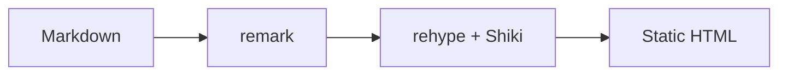

默认的 Shiki 管道在构建时进行语法高亮，采用 `github-light` / `github-dark` 双主题。以下功能通过围栏元数据按需开启。

## 标题栏

```ts title="src/app.ts"
export const greet = (name: string) => `Hello, ${name}!`;
```

## 行号

```python linenos
def fib(n):
    if n < 2:
        return n
    return fib(n - 1) + fib(n - 2)
```

## 高亮行

```rust {2,4-6}
fn main() {
    let x = compute();
    println!("{x}");
    if x > 10 {
        warn();
        recover();
    }
}
```

## 标题 + 行号 + 高亮组合

```tsx title="components/CodeBlock.tsx" linenos {3,7-9}
import { highlightToHast } from '@/lib/shiki';
import { toHtml } from 'hast-util-to-html';
import CodeBlockToolbar from './CodeBlockToolbar';

export default async function CodeBlock({ language, children, title }) {
  const hast = await highlightToHast(children, language, { title });
  const html = toHtml(hast);
  return (
    <div className="cb-root">
      {title && <span className="cb-title">{title}</span>}
      <CodeBlockToolbar code={children} />
      <div dangerouslySetInnerHTML={{ __html: html }} />
    </div>
  );
}
```

## 带红/绿背景的 Diff

```diff
-export const VERSION = "1.0";
+export const VERSION = "2.0";
 export const NAME = "amytis";
-export const STAGE = "alpha";
+export const STAGE = "beta";
```

## 自动换行开关

默认情况下，代码块中的长行会水平溢出——代码块底部会出现滚动条。点击任意代码块头部的 **Wrap** 按钮，可将长行软换行为多个可视行；再次点击则恢复水平滚动。

```bash
curl -X POST "https://api.example.com/v1/items?fields=id,name,description,createdAt,updatedAt&sort=createdAt:desc&limit=100&offset=0&filter[status]=active&filter[category]=blog&include=author,tags" -H "Authorization: Bearer YOUR_API_TOKEN_HERE" -H "Content-Type: application/json" -d '{"name":"example","description":"a sufficiently long single line to demonstrate the wrap toggle"}'
```

试试上方代码块头部的 **Wrap** 按钮 ↑，看看长行如何折叠成多个软换行的行。

## Mermaid 仍然可用（回归检查）



## 标签页式代码组

将相邻的围栏代码块包裹在 `:::code-group` 容器指令中，即可将它们组合成一个带标签页的小部件。标签页名称来自语言之后的 `[label]` 标记。该机制纯由 CSS 实现（单选输入 + 兄弟选择器）——零 JavaScript、零水合开销。

当标签页名称匹配已知的包管理器、语言或常见配置文件名时，标签前会自动显示一个图标。解析逻辑由 `src/lib/code-group-icons.ts` 中的 `resolveCodeGroupIcon` 处理。

:::code-group
```bash [npm]
npm install amytis
```
```bash [yarn]
yarn add amytis
```
```bash [pnpm]
pnpm add amytis
```
```bash [bun]
bun add amytis
```
:::

文件名标签同样可以解析——例如 `tsconfig.json`、`vite.config.ts` 或 `Dockerfile`：

:::code-group
```json [tsconfig.json]
{ "compilerOptions": { "target": "es2022", "module": "esnext" } }
```
```ts [vite.config.ts]
import { defineConfig } from 'vite';
export default defineConfig({ server: { port: 5173 } });
```
```dockerfile [Dockerfile]
FROM node:20-alpine
WORKDIR /app
COPY . .
RUN npm ci && npm run build
```
:::

标签页也可以跨语言使用——便于用多种实现展示同一算法：

:::code-group
```ts [TypeScript]
export function greet(name: string): string {
  return `Hello, ${name}!`;
}
```
```python [Python]
def greet(name: str) -> str:
    return f"Hello, {name}!"
```
```rust [Rust]
fn greet(name: &str) -> String {
    format!("Hello, {name}!")
}
```
:::

## 标注注释

使用 `// [!code …]` 注释为单独的行添加标注。支持六种标记——focus、diff、highlight、error、warning——使用语言的原生注释风格（C 系语言用 `//`，Python 用 `#`，SQL 用 `--` 等）：

```ts
function login(user: string) {            // [!code focus]
  const token = oldApi.auth(user)         // [!code --]
  const token = newApi.auth({ user })     // [!code ++]
  validate(token)                         // [!code highlight]
  throwIfExpired(token)                   // [!code error]
  if (!token.refreshable) warn()          // [!code warning]
  return token
}
```

`// [!code focus]` 会淡化代码块的其余部分，使聚焦的子集更加突出；悬停在代码块上可显示被淡化的行。`// [!code error]` / `[!code warning]` 会为该行添加彩色左边框（红色 / 琥珀色）。`[!code ++]` / `[!code --]` 可为单独的行着色，无需使用 `diff` 语言的围栏代码块。

标注注释适用于**任何**语言——例如 Python：

```python
def fib(n):
    if n < 2: return n          # [!code focus]
    return fib(n-1) + fib(n-2)
```

## GitHub 风格的提示框

在引用块的第一行添加 `[!TYPE]` 标记，即可将其渲染为 GitHub 风格的提示框。支持五种类型，每种都有自己的颜色、图标和标签：

> [!NOTE]
> 突出显示用户即使快速浏览也应留意的信息。

> [!TIP]
> 帮助用户更顺利完成的可选信息。

> [!IMPORTANT]
> 用户成功所必需的关键信息。

> [!WARNING]
> 因潜在风险而需要用户立即关注的关键内容。

> [!CAUTION]
> 某项操作可能带来的负面后果。

rST 的等价形式（`.. note::` / `.. tip::` / `.. important::` / `.. warning::` / `.. caution::`）通过 docutils 的 admonition 指令以相同的颜色渲染——两种管道的视觉效果保持一致。

## 显式纯文本

```plaintext
This block opts out of syntax highlighting entirely. Use `plaintext` (or its
aliases `text`, `txt`, `plain`) for prose-like blocks where token coloring
would be noisy or misleading. Unknown language names will fail the build.
```
