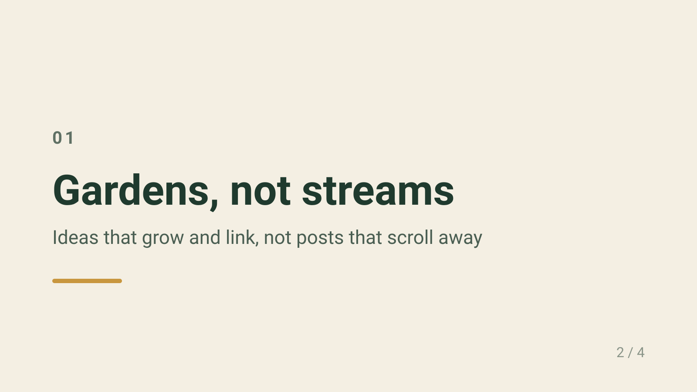

本文测试 Amytis 如何渲染通过原生 HTML iframe 和 HTML5 媒体元素嵌入的多媒体内容。由于启用了 `rehype-raw`，标准 HTML 嵌入代码可以直接在 Markdown 中使用。

---

## YouTube 视频

使用带内边距的包装容器实现的响应式 16:9 YouTube 嵌入：

<div style="position: relative; padding-bottom: 56.25%; height: 0; overflow: hidden; border-radius: 12px; margin: 1.5rem 0;">
  <iframe
    src="https://www.youtube.com/embed/jNQXAC9IVRw?rel=0"
    style="position: absolute; top: 0; left: 0; width: 100%; height: 100%; border: 0;"
    allow="accelerometer; autoplay; clipboard-write; encrypted-media; fullscreen; gyroscope; picture-in-picture; web-share"
    title="Me at the zoo — first YouTube video ever uploaded (2005)"
  ></iframe>
</div>

*"Me at the zoo"——上传到 YouTube 的第一个视频（2005 年 4 月 23 日）。*

---

## Vimeo 视频

Vimeo 同样支持响应式 16:9 嵌入：

<div style="position: relative; padding-bottom: 56.25%; height: 0; overflow: hidden; border-radius: 12px; margin: 1.5rem 0;">
  <iframe
    src="https://player.vimeo.com/video/76979871?color=ff9933&title=0&byline=0&portrait=0"
    style="position: absolute; top: 0; left: 0; width: 100%; height: 100%; border: 0;"
    allow="autoplay; fullscreen; picture-in-picture"
    title="Big Buck Bunny — Blender Foundation (Vimeo)"
  ></iframe>
</div>

*《Big Buck Bunny》（2008）——Blender 基金会出品的开源动画短片。*

---

## 播客嵌入

### Spotify 播客

Spotify 为单集播客提供固定高度的 iframe 嵌入：

<iframe
  src="https://open.spotify.com/embed/episode/0b8q6Q7fKqZLlSc0Lh1WQe?utm_source=generator&theme=0"
  style="border-radius: 12px; margin: 1rem 0;"
  width="100%"
  height="152"
  frameborder="0"
  allow="autoplay; clipboard-write; encrypted-media; fullscreen; picture-in-picture"
  loading="lazy"
  title="Spotify Podcast Episode"
></iframe>

你也可以以更高的高度（352px）嵌入完整的节目播放器，以显示单集列表：

<iframe
  src="https://open.spotify.com/embed/show/5as3aKmN2k11yfDDDSrvaZ?utm_source=generator"
  style="border-radius: 12px; margin: 1rem 0;"
  width="100%"
  height="352"
  frameborder="0"
  allow="autoplay; clipboard-write; encrypted-media; fullscreen; picture-in-picture"
  loading="lazy"
  title="Spotify Show Player"
></iframe>

### Apple Podcasts

Apple Podcasts 采用类似的 iframe 嵌入方式：

<iframe
  src="https://embed.podcasts.apple.com/us/podcast/syntax-tasty-web-development-treats/id1253186678?itsct=podcast_box_player&amp;itscg=30200&amp;ls=1&amp;theme=auto"
  height="175px"
  frameborder="0"
  sandbox="allow-forms allow-popups allow-same-origin allow-scripts allow-top-navigation-by-user-activation"
  allow="autoplay *; encrypted-media *; clipboard-write"
  style="width: 100%; max-width: 660px; overflow: hidden; border-radius: 10px; margin: 1rem 0; display: block;"
  title="Apple Podcasts — Syntax.fm"
></iframe>

---

## 直播嵌入

### YouTube 直播

YouTube 直播频道或正在进行的直播视频可以像普通视频一样嵌入。使用频道的直播 URL（`/live`）或直播活动 ID：

```html
<!-- Replace CHANNEL_ID with the YouTube channel ID -->
<iframe
  src="https://www.youtube.com/embed/live_stream?channel=CHANNEL_ID"
  ...
></iframe>
```

以下是 NASA 的公共直播流：

<div style="position: relative; padding-bottom: 56.25%; height: 0; overflow: hidden; border-radius: 12px; margin: 1.5rem 0;">
  <iframe
    src="https://www.youtube.com/embed/xAieE-QtOeM?autoplay=0"
    style="position: absolute; top: 0; left: 0; width: 100%; height: 100%; border: 0;"
    allow="accelerometer; autoplay; clipboard-write; encrypted-media; fullscreen; gyroscope; picture-in-picture"
    title="NASA TV Live"
  ></iframe>
</div>

### Twitch 直播

Twitch 要求在 `parent` 查询参数中填入你网站的域名（这样嵌入代码才能在生产环境中正常工作）：

```html
<!-- Replace CHANNEL_NAME with a Twitch channel, and your-domain.com with your domain -->
<iframe
  src="https://player.twitch.tv/?channel=CHANNEL_NAME&parent=your-domain.com"
  height="378"
  width="100%"
  allow="fullscreen"
  title="Twitch Stream"
></iframe>
```

Twitch 还支持嵌入往期直播录像（VOD）和精彩片段：

```html
<!-- VOD -->
<iframe src="https://player.twitch.tv/?video=VOD_ID&parent=your-domain.com" ...></iframe>
<!-- Clip -->
<iframe src="https://clips.twitch.tv/embed?clip=CLIP_SLUG&parent=your-domain.com" ...></iframe>
```

---

## HTML5 原生媒体

原生 `<video>` 和 `<audio>` 元素无需任何第三方嵌入即可正常工作。

### HTML5 视频

<video controls style="width: 100%; border-radius: 12px; margin: 1rem 0; background: #000;" poster="https://peach.blender.org/wp-content/uploads/title_anouncement.jpg">
  <source src="https://commondatastorage.googleapis.com/gtv-videos-bucket/sample/ElephantsDream.mp4" type="video/mp4" />
  你的浏览器不支持 HTML5 视频元素。
</video>

*《Elephants Dream》（2006）——Blender 基金会出品的首部开源动画电影。*

可用的属性：

| 属性 | 说明 |
| :--- | :--- |
| `controls` | 显示播放控件 |
| `autoplay` | 自动开始播放（需与 `muted` 配合使用） |
| `muted` | 默认静音（自动播放所必需） |
| `loop` | 循环播放视频 |
| `poster` | 播放前显示的预览图 |
| `preload` | `auto` \| `metadata` \| `none` |

### HTML5 音频

<audio controls style="width: 100%; margin: 1rem 0;">
  <source src="https://www.soundhelix.com/examples/mp3/SoundHelix-Song-1.mp3" type="audio/mpeg" />
  你的浏览器不支持 HTML5 音频元素。
</audio>

*SoundHelix 免版税示例曲目。*

提供多种格式可以提升跨浏览器兼容性：

```html
<audio controls>
  <source src="audio.ogg" type="audio/ogg" />
  <source src="audio.mp3" type="audio/mpeg" />
  Your browser does not support the HTML5 audio element.
</audio>
```

---

## 音频平台

### SoundCloud

在任意曲目的“分享 → 嵌入”菜单中，SoundCloud 会提供 iframe 嵌入代码：

<iframe
  width="100%"
  height="166"
  scrolling="no"
  frameborder="no"
  allow="autoplay"
  style="border-radius: 8px; margin: 1rem 0;"
  src="https://w.soundcloud.com/player/?url=https%3A//api.soundcloud.com/tracks/1&color=%23ff5500&auto_play=false&hide_related=false&show_comments=true&show_user=true&show_reposts=false&show_teaser=true"
  title="SoundCloud track"
></iframe>

完整的可视化播放器（高度为 300px）会显示波形：

```html
<iframe
  width="100%"
  height="300"
  src="https://w.soundcloud.com/player/?url=TRACK_URL&visual=true"
  ...
></iframe>
```

### Bandcamp

Bandcamp 同时提供专辑和曲目两种嵌入代码：

```html
<!-- Album embed -->
<iframe
  style="border: 0; width: 100%; height: 120px;"
  src="https://bandcamp.com/EmbeddedPlayer/album=ALBUM_ID/size=large/bgcol=ffffff/linkcol=0687f5/"
  seamless
></iframe>
```

---

## 幻灯片

将演讲幻灯片导出为图片（Keynote、PowerPoint、Google Slides）后，放入 `:::slides` 区块中，每张幻灯片对应一个 Markdown 图片。可以使用箭头按钮、方向键或滑动手势翻页；点击某张幻灯片或按 <kbd>F</kbd> 进入全屏演示视图；使用 `#slides-3` 链接到某张幻灯片。

:::slides[构建数字花园 — XConf 2026]{video="https://www.youtube.com/watch?v=jNQXAC9IVRw"}




:::

```markdown
:::slides[Building a Digital Garden — XConf 2026]{pdf="./talk.pdf" video="https://youtu.be/…"}


:::
```

`bun run new-slides <export-folder-or-pdf> --into <post-folder>` 会将导出的内容复制到位并打印出该区块。参见 `docs/SLIDES.md`。

---

## 嵌入最佳实践

嵌入第三方媒体时，请注意以下几点：

- **响应式尺寸**：将 iframe 包裹在 `padding-bottom: 56.25%; position: relative` 容器中，以保持 16:9 的宽高比。
- **`loading="lazy"`**：为首屏以下的嵌入内容添加此属性，以延迟加载并提升页面速度。
- **`title` 属性**：始终提供描述性的 `title`，以保障屏幕阅读器的无障碍访问。
- **隐私增强模式**：YouTube 支持 `youtube-nocookie.com`，可在嵌入内容不自动播放时减少跟踪。
- **用 `allow` 替代 `allowfullscreen`**：使用 `allow="fullscreen"` 而非已弃用的 `allowfullscreen` 布尔属性。注意，单独的 `allow="fullscreen"` 会将全屏限制在 iframe 自身的源（更安全），而旧的 `allowfullscreen` 相当于 `allow="fullscreen *"`（任意源）。对于 YouTube 或 Vimeo 等第三方嵌入，`allow="fullscreen"` 是正确且推荐的形式。当两个属性同时存在时，浏览器会警告 `allow` 优先。
- **`sandbox` 属性**：用于不受信任的嵌入内容，以限制 iframe 的行为。
- **Twitch 的 `parent` 参数**：要让嵌入内容在 localhost 之外正常工作，Twitch 要求在 `parent` 中包含你网站的主机名。

```html
<!-- YouTube privacy-enhanced embed -->
<iframe
  src="https://www.youtube-nocookie.com/embed/VIDEO_ID?rel=0"
  ...
></iframe>
```
